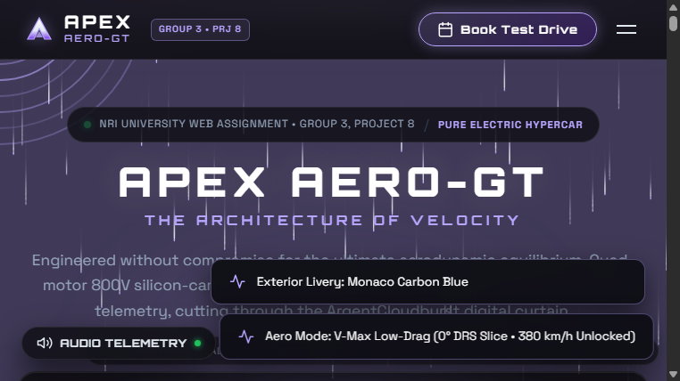

# APEX AERO-GT | Electric Hypercar Showroom
### Activity 3 — NRI University Web Assignment • Group 3, Project 8
**Student Attribution:** Developed by **Nagendra Varma**  
**Live GitHub Pages Deployment:** [https://mvnrkvarma2009.github.io/html_css_activity-3/](https://mvnrkvarma2009.github.io/html_css_activity-3/)  
**GitHub Repository:** [https://github.com/mvnrkvarma2009/html_css_activity-3](https://github.com/mvnrkvarma2009/html_css_activity-3)



---

## 1. Project Context & Design Aesthetic
This project constitutes **Activity 3** for the NRI University Web Assignment portfolio under the theme of **Luxury Car Showroom / Automotive Showcase** (Group 3, Project 8).

- **Project Name:** APEX AERO-GT | Electric Hypercar Showroom
- **Concept:** Next-generation 1,450 BHP quad-motor electric hypercar engineered for aerodynamic equilibrium and track telemetry supremacy.
- **Design Aesthetic:**
  - **Matte Carbon:** `#0A0A0C` (ultra-deep technical black)
  - **Liquid Titanium:** `#E2E8F0` and `#94A3B8` (specular reflections and brushed trim)
  - **Lavender Horizon:** `#B8A5FE` (ambient light bar, aerodynamic glows, active telemetry HUD highlights)
  - **Silver Chrome:** `#F8FAFC` (precision highlights and edge accents)
- **Strict Architectural Constraints:**
  - **Strictly Zero Emojis:** 100% of icons are rendered via high-precision inline Lucide SVG vector symbols.
  - **100% Vanilla Web Stack:** Zero build tools, zero bundlers, zero npm dependencies required for runtime. Fully compatible with static GitHub Pages hosting.

---

## 2. Interactive Background Shader: ArgentCloudburst
The website features the **Originkit ArgentCloudburst Digital Rain Curtain** rendered in real time on a full-screen HTML5 Canvas:
- **Suspended Light Bar:** Cascades downward from an ultra-thin lavender horizon light bar (`#B8A5FE`) fixed at the top of the viewport.
- **Silver Rain Strands:** Over 120 dynamic falling digital rain strands shimmering with titanium luminescence and alpha trails.
- **Pointer Hover Parting:** As the cursor sweeps across the screen, raindrops calculate distance and deflect outward horizontally, recreating the tactile sensation of parting a physical curtain with your hand.
- **Cursor Wind Shear:** Cursor sweep velocity introduces an angular wind shear force (`windLean`), leaning the digital curtain dynamically.
- **Tap / Click Lightning Discharge:** Clicking anywhere triggers an ambient double-flash lightning pulse with electrical charge ripples radiating across raindrops.
- **Hold-Press Cloudburst Surge:** Holding mouse-down or touch-down ramps up rain density and velocity (up to 3.5× speed), easing smoothly back to calm rain upon release.
- **60 FPS Performance:** Optimized requestAnimationFrame loop with `devicePixelRatio` scaling (clamped to 2) and minimal garbage collection.

---

## 3. Core Showroom Sections & Interactive Features

### 1. Navigation Bar
- APEX AERO-GT aerodynamic insignia and brand badge.
- Navigation links with smooth scroll spying (`Overview`, `Configurator`, `Aerodynamics`, `Trims`, `Telemetry`, `Cockpit`).
- "Book Test Drive" direct modal trigger.
- Floating **Web Audio Telemetry Toggle** (synthesizes electric hypercar motor hum, DRS switches, and confirmation chimes using pure browser Web Audio API).

### 2. Hero Stage & Precision Vector Hypercar
- Low-slung, aerodynamically sculpted vector hypercar cutting through the ArgentCloudburst digital curtain.
- **Interactive 3D Tilt Parallax:** Moving the mouse over the stage tilts the hypercar in perspective 3D.
- **Laser Matrix Headlights:** Toggleable high-beam projector light cone with lens flares.
- **Wind-Tunnel Streamlines:** Toggleable CFD aerodynamic particle streamline overlay flowing smoothly across roof and diffuser.
- **Live Telemetry Stats Matrix:**
  - `0–100 km/h`: **1.82s**
  - `Peak Output`: **1,450 BHP** (Quad-Motor Silicon-Carbide)
  - `Top Velocity`: **380 km/h**
  - `WLTP Range`: **820 km** (120 kWh solid-matrix pack)

### 3. Interactive Livery & Aero Configurator
- **Real-Time Livery Switcher:**
  - *Apex Liquid Silver* (`#E2E8F0` / `#94A3B8`)
  - *Monaco Carbon Blue* (`#38BDF8` / `#1D4ED8`)
  - *Verde Acid* (`#A3E635` / `#4D7C0F`)
  - *Solaris Amber* (`#FBBF24` / `#D97706`)
- **Composite Finish Switcher:** Titanium High-Gloss, Stealth Satin Matte, Raw Forged Weave.
- **Active Aero Mode Toggle:**
  - **Track Downforce Mode:** Active rear wing deploys +28° angle of attack, front splitters extend forward, downforce hits 850 kg (Cd 0.38, 2.15 G cornering).
  - **V-Max Low-Drag Mode:** Active rear wing flattens to 0° air-slice, active flaps retract flush, downforce shifts to 220 kg (Cd 0.21, 380 km/h unlocked).
- **Forged Wheel Architecture:** 20"/21" Aero-Blade Carbon Discs vs Ultra-Light Forged Magnesium.
- **Real-Time CFD Telemetry Readout:** Live bar gauges showing Front Splitter, Underbody Venturi, and Rear Wing aerodynamic distribution.

### 4. Hypercar Trims Showcase (Group 3 Rubric)
Three production trims priced in Ex-Showroom Indian Rupees (₹ INR):
1. **Aero Sprint (₹3.85 Cr):** 1,150 BHP, 0–100 km/h in 2.10s, 750 km Range, Grand Touring Aero.
2. **Nürburgring Track Edition (₹4.50 Cr — Featured):** 1,450 BHP, 0–100 km/h in 1.82s, 820 km Range, Full DRS Active Wing, 420mm Carbon-Ceramic Matrix Discs.
3. **Le Mans GT Hyper-Bespoke (₹5.20 Cr):** 1,600 BHP, 0–100 km/h in 1.69s, 400+ km/h, Full Exposed Forged Carbon Monocoque, 24K Gold Foil Heat Shielding.

### 5. Engineering & Telemetry HUD Matrix
- **Active Downforce & Velocity Gauge:** Interactive speed scrubber (0–380 km/h) recalculating real-time aerodynamic downforce, drag resistance (N), and downforce-to-mass ratio with a circular SVG progress dial.
- **Carbon-Ceramic Brake Thermal Simulator:** Interactive "HOLD TO APPLY THRESHOLD BRAKE" button that climbs rotor temperatures from 180°C up to 820°C with glowing red/orange heat gradient and overheat alert, followed by ram-air cooling fans upon release.
- **800V Solid-State Battery Matrix:** 4 individual pack cell monitors (FL, FR, RL, RR) with real-time thermal fluctuations, torque vectoring balance, and closed-loop glycol chiller flow rate.

### 6. Cockpit & Interior Gallery
- 3 Driver-Centric Perspectives:
  1. **Carbon-Weave Yoke Steering:** Precision SVG yoke with integrated OLED telemetry display, titanium paddle shifters, and interactive technical hotspots.
  2. **Holographic Windshield HUD:** Collimated projection of target apex braking points and lateral G-meter.
  3. **Bespoke Alcantara Stitch Viewer:** Interactive stitch customizer synchronizing thread color with exterior livery accents.

### 7. VIP Test Drive Booking Modal
- Custom booking flow with city selection:
  - **Hyderabad** (Jubilee Hills Experience Centre)
  - **Bengaluru** (Lavelle Road Flagship Atelier)
  - **Mumbai** (Bandra-Kurla Complex Studio)
  - **Delhi** (Golf Links Atelier)
- Track session selection (Morning Telemetry, Sunset Sprint, Midnight Runway Run).
- Form validation, dynamic price binding, and driver license confirmation.
- Generates a digital **Holographic VIP Access Pass** with unique serial number (`APX-2026-HYD-XXX`), barcode matrix, and print/save functionality.

### 8. Footer with Originkit Hero-55 Scramble Text
- Attribution Banner: `"Website developed for NRI University Web Assignment • Made by Nagendra Varma"`
- Incorporates the **Originkit hero-55 character scramble effect** (`░▒▓█` + alphanumeric cipher matrix) resolving into "Nagendra Varma" on page load, hover, and via the interactive **RE-ENCRYPT** button.

---

## 4. File Structure
```
html_css_activity-3/
├── index.html        # Semantic HTML5 with Lucide SVG symbols & zero emojis
├── style.css         # Dark telemetry CSS3 design system with custom properties
├── script.js         # Modular ES6: ArgentCloudburst canvas, configurator, HUD, modal, audio
└── README.md         # Full project documentation & university submission details
```

---

## 5. Deployment Instructions
This repository is configured for automated hosting on **GitHub Pages**:
1. Commit all files to the `main` branch.
2. Under Repository **Settings** > **Pages**, set **Source** to `Deploy from a branch` and choose `/ (root)`.
3. The site is live at: `https://mvnrkvarma2009.github.io/html_css_activity-3/`

---
*Created for NRI University Web Assignment • Activity 3 • Group 3, Project 8 • Automotive Luxury Showroom.*
